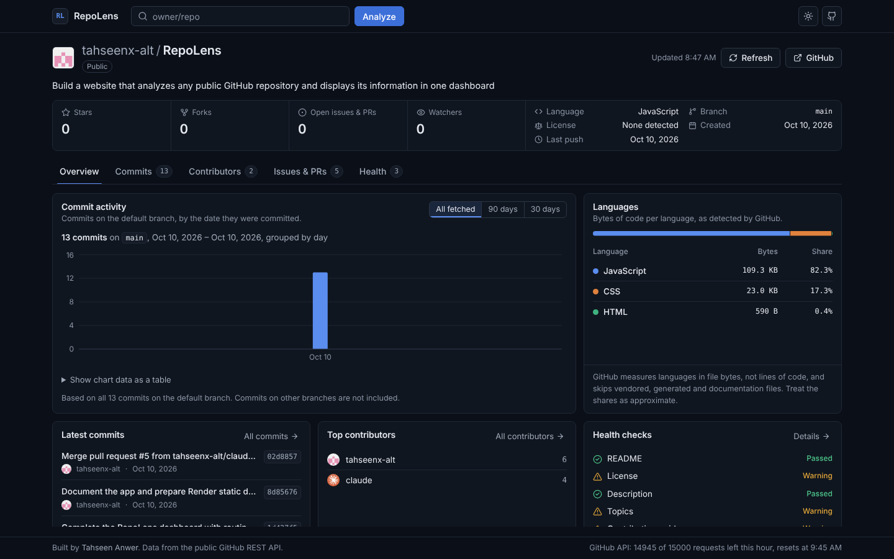
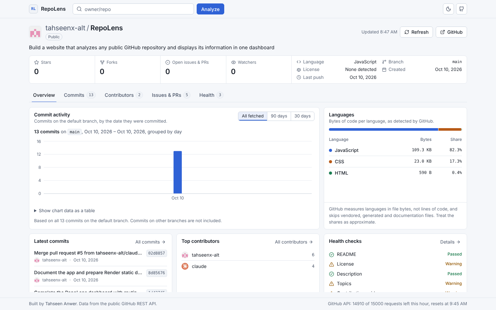
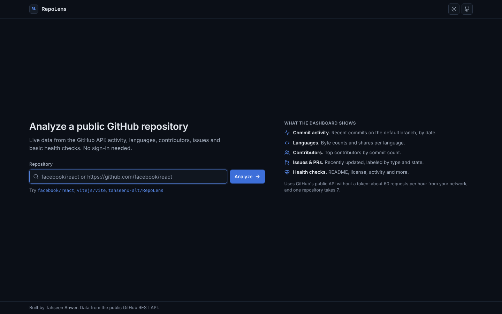
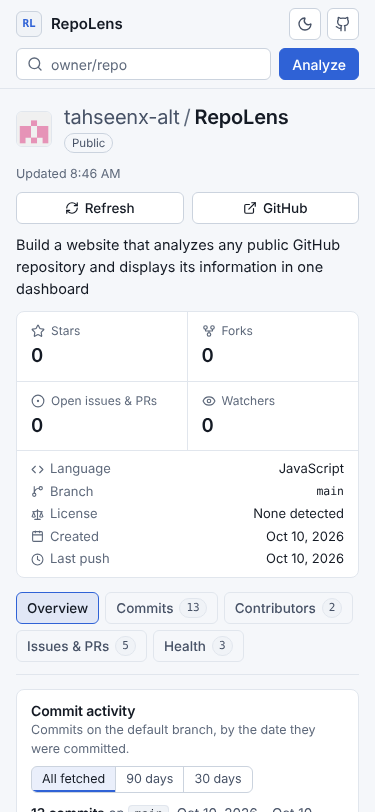

# RepoLens

**GitHub repository intelligence dashboard.** Enter any public GitHub repository and RepoLens
shows its key numbers, commit activity, languages, contributors, issues and pull requests, and a
set of basic health checks on one screen, in a light or dark theme. All data comes live from the public GitHub REST API. No
sign-in, token or backend is needed.

## Features

All of these are implemented and use real API data. Nothing is filled in with sample values.

- **Repository search** that accepts `owner/repo`, `https://github.com/owner/repo`, `github.com/owner/repo`,
  links to sub-pages (like `/tree/main/src`) and `git@github.com:owner/repo.git`. It rejects other
  domains and malformed input with a specific message, shows a loading state, and blocks duplicate
  submissions.
- **Shareable dashboard URLs** such as `/facebook/react`. The owner and repository in the address
  are validated before any request is made. Browser back and forward work as expected.
- **Repository overview**: owner, name, description, link to GitHub, the four key numbers (see
  below), primary language, default branch, license, creation date, last push date, homepage,
  topics, fork/archived labels, and the time the data was loaded. A number GitHub didn't send, or
  sent in an unexpected form, is shown as **"Unavailable"**. A **0** is only shown when GitHub
  itself reports 0.
- **Commit activity** chart (Recharts) for the latest 100 commits on the default branch, grouped
  by day, week or month depending on the time span. You can switch between "all fetched", 90 days
  and 30 days. The panel states exactly which period and how many commits it covers. When GitHub
  had more commits than were fetched, the chart starts at the oldest fetched commit instead of
  showing unknown days as zero. The chart data is also available as a table.
- **Languages**: a stacked bar plus a table of byte counts and percentages, with a note that
  GitHub measures bytes, not lines of code.
- **Contributors**: top 20 by commits on the default branch, with avatars and profile links.
  Commits whose email isn't linked to a GitHub account are shown as such. A note explains that
  commit counts don't measure the value of anyone's work.
- **One-screen tabbed dashboard**: the repository header and key numbers stay at the top, and the
  details are split into tabs (Overview, Commits, Contributors, Issues & PRs, Health). On screens
  at least 1024×680 the page itself never scrolls; only the active tab's content does. Phones and
  small tablets scroll normally. The tab is kept in the URL (`?tab=commits`), so links open the
  same view. Tabs work with the mouse and with the arrow, Home and End keys.
- **Recent commits**: message (cut cleanly when long), author, date, short SHA and a link to the
  commit, 10 at a time.
- **Issues and pull requests**: the 30 most recently updated items (open and closed), labeled as
  "Issue" or "Pull request" and by state (Open, Draft, Merged, Closed, Not planned) with both an
  icon and text. Filter by type without new requests.
- **Health checks**: eight rule-based checks (README, license, description, topics, contributing
  guide, recent commits, issue tracker, archive status). Each shows Passed, Warning or Unavailable,
  a short explanation, a suggestion where useful, and the API data it is based on. A failed request
  is reported as "Unavailable", never as "missing". There is no overall score, on purpose.
- **Recently analyzed** list saved in your browser (localStorage), with a "Clear history" button.
  Only public `owner/repo` names are stored.
- **Refresh** button that clears the cached data for the repository and loads it again.
- **Loading, empty and error states** in every section. If one request fails (for example
  contributors for a very large repository), the rest of the dashboard still works, and that
  section has a "Try again" button.
- **Rate-limit aware**: the footer shows how many GitHub API requests are left, and rate-limit
  errors say when the limit resets.
- **Light and dark themes**: the first visit follows your system setting. The sun/moon button in
  the header switches immediately, and the choice is saved in your browser (localStorage key
  `repolens:theme`, which holds only `light` or `dark`). The theme is applied before the page
  draws, so there is no flash of the wrong theme.
- **Quiet animations**: the dashboard and each tab fade in, the chart bars and language bar grow
  in, buttons respond to hover and press, the theme fades between colors, loading skeletons
  shimmer, and a search error shakes once. If your system asks for reduced motion, all of these are
  turned off.
- **Responsive and accessible**: works from 320px phones to wide desktops without horizontal
  scrolling, keyboard focus is always visible, inputs are labeled, status is never shown by color
  alone, and text colors meet WCAG AA contrast in both themes.

### The four key numbers

| Shown as | GitHub API field | Notes |
| -------- | ---------------- | ----- |
| Stars | `stargazers_count` | |
| Forks | `forks_count` | |
| Open issues & PRs | `open_issues_count` | GitHub counts open issues and open pull requests together in this field. |
| Watchers | `subscribers_count` | People who get notifications. The similarly named `watchers_count` field is actually a copy of the star count, so it isn't used. |

## Screenshots

Taken from the production build, analyzing this repository.

| Dashboard, dark theme | Dashboard, light theme |
| --------------------- | ---------------------- |
|  |  |

| Start page | Phone |
| ---------- | ----- |
|  |  |

## Tech stack

- [React 19](https://react.dev) with JavaScript (no TypeScript)
- [Vite](https://vite.dev) for the dev server and production build
- [React Router](https://reactrouter.com) for the `/owner/repo` pages
- [Recharts](https://recharts.org) for the commit activity chart
- [Lucide React](https://lucide.dev) for icons
- Plain CSS with CSS variables (`src/styles/`). Tailwind was planned at first, but the existing
  project already used plain CSS, so it was kept to avoid a second styling system.
- [Vitest](https://vitest.dev) and [React Testing Library](https://testing-library.com) for tests
- [Oxlint](https://oxc.rs) for linting
- GitHub REST API (public, unauthenticated)

## Running it locally

You need **Node.js 22.12 or newer** (check with `node -v`).

```bash
git clone https://github.com/tahseenx-alt/RepoLens.git
cd RepoLens
npm install
npm run dev
```

Then open the address Vite prints (usually http://localhost:5173).

> **Seeing `Failed to resolve import "recharts"`?** That error means the packages listed in
> `package.json` haven't been installed on your computer yet. Run `npm install` again after every
> `git pull`, because new commits can add packages.

### Commands

| Command | What it does |
| ------- | ------------ |
| `npm run dev` | Starts the development server with live reload |
| `npm run build` | Builds the production site into `dist/` |
| `npm run preview` | Serves the built `dist/` folder locally to check it |
| `npm test` | Runs all tests once |
| `npm run test:watch` | Re-runs tests when files change |
| `npm run test:coverage` | Runs the tests and prints how much of the code they cover |
| `npm run lint` | Checks the code with Oxlint |

The project uses Oxlint rather than ESLint, so `npm run lint` is the only lint command.

## Project structure

```
src/
  api/github.js          All GitHub requests, caching, error and rate-limit handling
  pages/                 HomePage, DashboardPage (/owner/repo), NotFoundPage
  components/
    layout/              Site header and footer, theme provider and theme button
    search/              Repository search form and recent history list
    dashboard/           Repository header, tabs and one component per panel
    charts/              Commit activity chart and language breakdown
    ui/                  Tabs, Panel, loading/error/empty states, skeleton, GitHub logo
  hooks/                 useGitHubData (loading state + retry), history, rate limit,
                         reduced-motion preference
  theme/                 Theme storage and chart colors for each theme
  utils/                 URL parsing, formatting, commit grouping, languages,
                         issues, health check rules, localStorage history
  styles/                base, layout, home and dashboard CSS
  tests/                 Vitest tests and recorded API fixtures
```

## GitHub API usage and rate limits

RepoLens calls the GitHub REST API directly from the browser without a token. GitHub allows
**about 60 unauthenticated requests per hour per IP address**. Opening one repository uses
**7 requests**:

| Request | Used for |
| ------- | -------- |
| `GET /repos/{owner}/{repo}` | Overview, license, description, topics, archive status |
| `GET /repos/{owner}/{repo}/languages` | Languages |
| `GET /repos/{owner}/{repo}/commits?per_page=100` | Activity chart, recent commits, activity check |
| `GET /repos/{owner}/{repo}/contributors?per_page=20&anon=1` | Contributors |
| `GET /repos/{owner}/{repo}/issues?state=all&sort=updated&per_page=30` | Issues and pull requests |
| `GET /repos/{owner}/{repo}/readme` | README check |
| `GET /repos/{owner}/{repo}/community/profile` | Contributing guide check |

So you can analyze roughly 8 repositories per hour. To save requests, answers are cached in memory
for 5 minutes, so going back to a repository or switching tabs and filters doesn't request
anything new. If two parts of the page ask for the same data at once, only one request is sent.
When you switch to another repository, answers that arrive late for the previous one are ignored,
so old numbers never appear on the new page. **Refresh** throws away the cached answers for that
repository and asks GitHub again.
RepoLens does not try to get around the limit and never uses or stores a token. When the limit is
reached, it says when you can try again.

Each list request fetches a single page, so the limits above (100 commits, 20 contributors, 30
issues/PRs) are stated in the interface wherever they matter.

## Testing

`npm test` runs 90+ tests with a fake `fetch`, so they never call GitHub. They cover URL parsing,
the API field mapping (including real zeros versus missing values), refresh, switching
repositories while requests are still running, tabs, errors, rate limits, history and the theme.

### Manual checks against the live API

These need a normal internet connection, because they call GitHub directly.

1. Run `npm run dev` and open the address Vite prints.
2. Search for `DemiGod108/Repo-Signals`. Open https://github.com/DemiGod108/Repo-Signals in another
   tab and compare Stars, Forks and Watchers ("Watching" on GitHub) with the dashboard. "Open
   issues & PRs" should equal GitHub's open issues plus open pull requests. At the time of writing
   all four are 0 on GitHub itself, so RepoLens should also show 0.
3. To see the exact values RepoLens uses, open
   https://api.github.com/repos/DemiGod108/Repo-Signals and look at `stargazers_count`,
   `forks_count`, `open_issues_count` and `subscribers_count`.
4. Search for `facebook/react` and compare the same way. Its numbers are large and change often,
   so small differences after a few minutes are normal.
5. Press **Refresh** on the dashboard. The "Updated" time should change, and any number that changed
   on GitHub should change too.
6. Switch quickly between the two repositories (search one, then the other before it finishes
   loading). The page should never show one repository's numbers under the other's name.
7. Click the sun/moon button, reload the page, and check that the theme stays. Clear the site's
   storage to go back to following the system setting.
8. Turn on "reduce motion" in your operating system and reload. Nothing should fade, slide or grow.

## Deploying to Render

RepoLens is a static site, so it can run on Render's free static hosting. No environment variables
or secrets are needed.

**Option A: Blueprint.** This repository contains a `render.yaml`. In Render choose
**New → Blueprint**, select this repository, and confirm.

**Option B: by hand.** In Render choose **New → Static Site**, select this repository, and use:

- **Build command:** `npm ci && npm run build`
- **Publish directory:** `dist`
- **Redirects/Rewrites** (under the site's settings): add a rule with source `/*`,
  destination `/index.html`, action **Rewrite**.

The rewrite rule is needed because dashboard URLs like `/facebook/react` don't exist as files. It
lets Render serve `index.html`, and React Router then shows the right page. Render uses the Node
version in `.node-version` (22).

Check the build locally first with `npm run build` followed by `npm run preview`.

## Known limitations

- **Rate limit**: about 60 requests per hour without a token (see above). Large repositories
  use the same 7 requests, but GitHub may answer more slowly.
- **Open issues & PRs** is one number because GitHub stores it that way. The Issues & PRs tab
  only lists the 30 most recently updated items, open or closed.
- **Commit activity** covers at most the latest 100 commits on the default branch. For busy
  repositories that may be only a few days. Other branches are not included.
- **Contributors**: GitHub only lists the top contributors, and for very large repositories it may
  refuse to compute the list. RepoLens then shows the error in that panel only.
- **Language shares** are based on file bytes as measured by GitHub, not lines of code.
- **Health checks** are basic signals about files and metadata. They don't measure code quality,
  security or how well a project is maintained.
- **Private repositories** can't be analyzed, since no sign-in is used.
- **One-screen layout** needs a window at least 1024 pixels wide and 680 pixels tall. Smaller
  windows scroll the page instead.

## Planned

These are ideas, not implemented yet:

- Repository comparison
- Shareable analysis reports
- More activity insights (for example using GitHub's statistics endpoints)
- AI-powered repository summaries
- Optional personal access token for higher rate limits (kept in memory only)

## Author

**Tahseen Anwer**

- GitHub: [@tahseenx-alt](https://github.com/tahseenx-alt)
